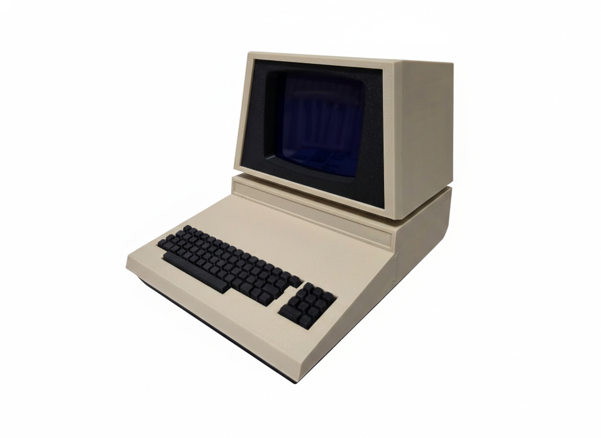
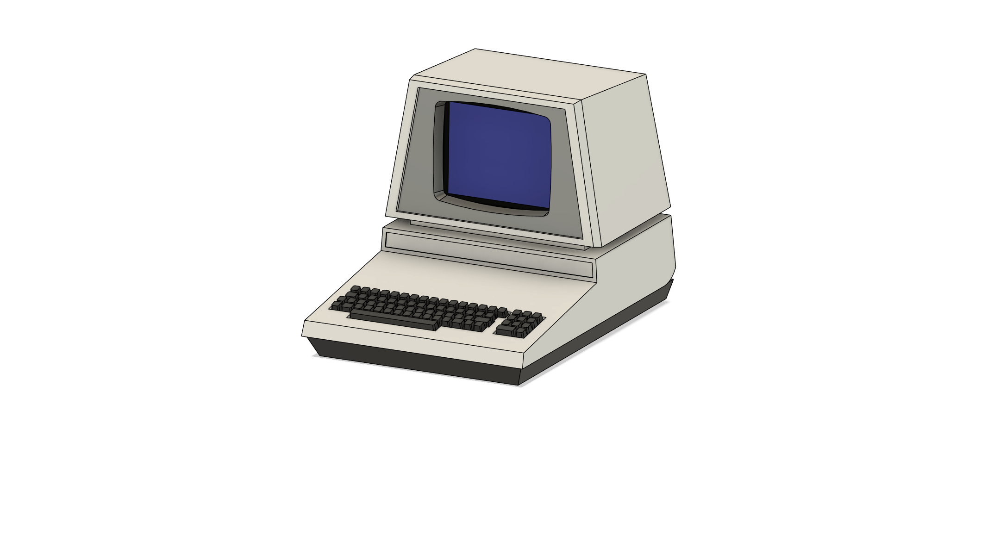
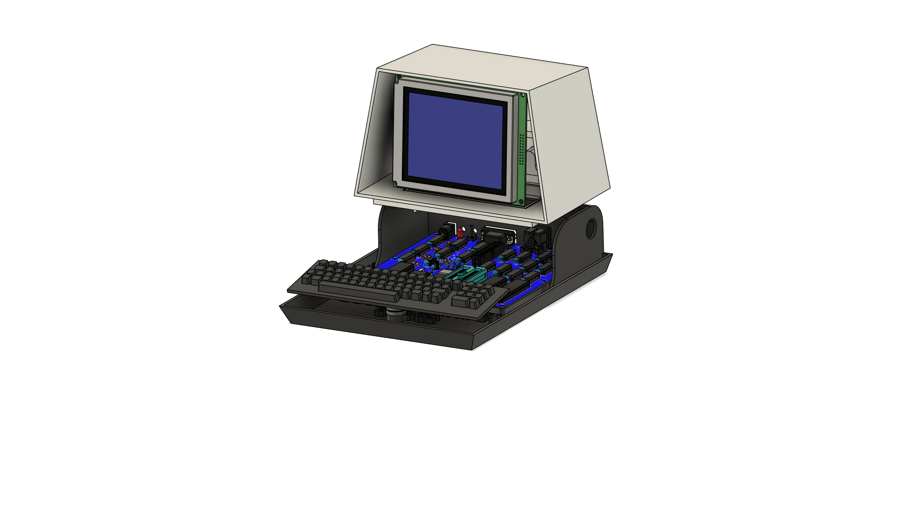
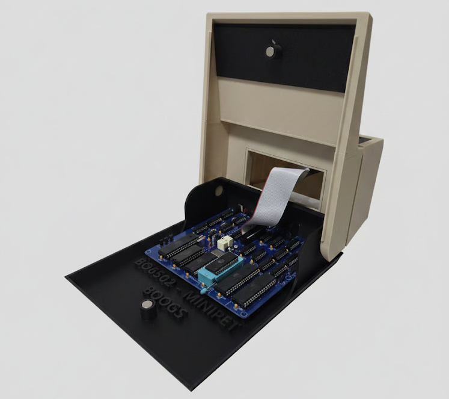
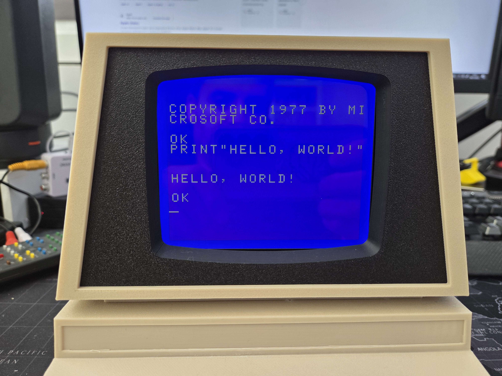
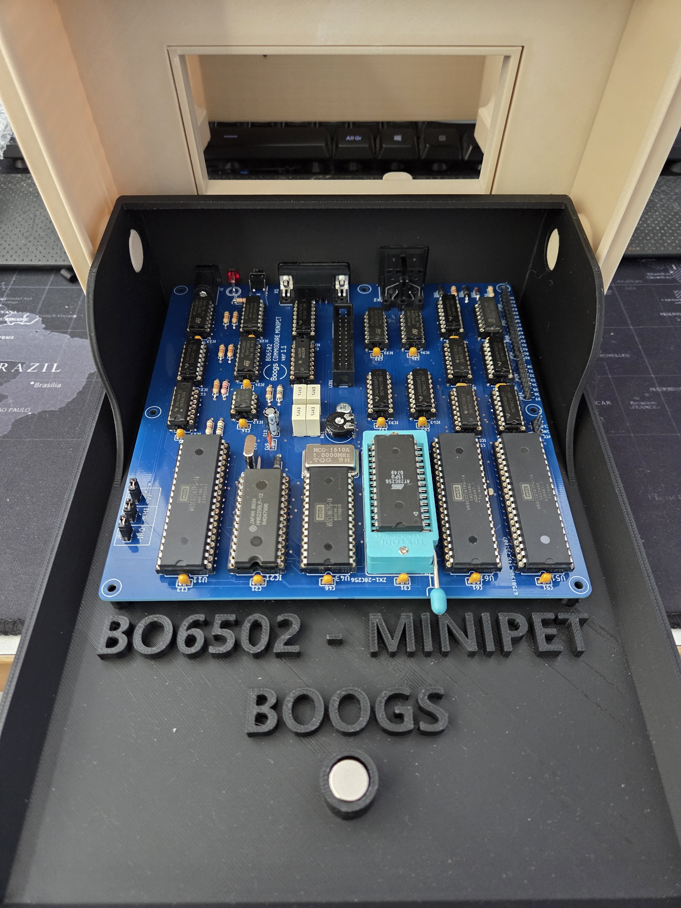
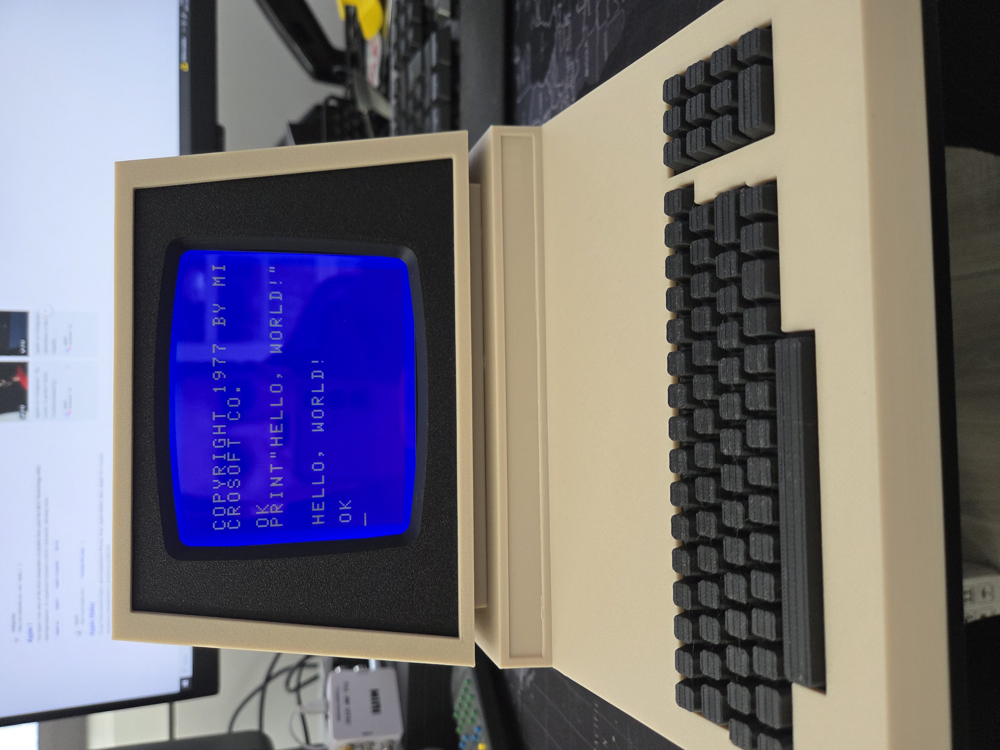

# miniPET: 65C02-Based Retro Computer

The **Boogs77-miniPET** is a compact, high-performance 8-bit computer inspired by the iconic Commodore PET aesthetics. Built around the **W65C02S** processor, this project utilizes the modular architecture of the [BO6502 System](https://github.com/Boogs77/BO6502_65C02-based_modular_computer) and integrates it into a custom-designed, 3D-printed enclosure.

---

## 🧠 System Architecture & Modules

The internal logic of the miniPET is derived directly from the modular boards of the BO6502 project. Each core component follows the same electrical and logical specifications:

### ⚙️ Core Processing Unit (CPU, RAM, ROM)
The system's "brain" and memory management are based on the high-reliability design of the BO6502:
* **CPU:** Western Design Center **W65C02S**, allowing for modern high-speed operation while maintaining full 6502 compatibility. Reference: [BO6502 CPU](https://github.com/Boogs77/BO6502_65C02-based_modular_computer/tree/main/BO6502%20CPU).
* **Clock:** System operates with a stable **1MHz** clock frequency. Reference: [BO6502 CPU](https://github.com/Boogs77/BO6502_65C02-based_modular_computer/tree/main/BO6502%20CPU).

### 🗺️ Memory Map
The memory layout is organized to ensure compatibility with the system firmware and modular hardware:
* **RAM (32KB):** Mapped from **$0000** to **$7FFF**. Reference: [BO6502 RAM](https://github.com/Boogs77/BO6502_65C02-based_modular_computer/tree/main/BO6502%20RAM).
* **ROM (32KB):** Mapped from **$8000** to **$FFFF**. Reference: [BO6502 ROM](https://github.com/Boogs77/BO6502_65C02-based_modular_computer/tree/main/BO6502%20ROM).

### 📟 Display Interface (BIGLCD)
The visual output is handled by the **BIGLCD** module. 
* **Addressing:** The module is mapped and accessible at memory address **$D19X**.
* **Reference:** [BO6502 BIGLCD](https://github.com/Boogs77/BO6502_65C02-based_modular_computer/tree/main/BO6502%20BIGLCD).

### ⌨️ Keyboard Input
Input is managed via a dedicated matrix keyboard interface.
* **Addressing:** The keyboard is mapped and accessible at memory address **$D18X**.
* **Reference:** [BO6502 KeyBoard Module](https://github.com/Boogs77/BO6502_65C02-based_modular_computer/tree/main/BO6502%20KEYb).

### 🔌 Serial Communication
Asynchronous communication is provided for external terminal access.
* **Addressing:** Accessible at the **$CXXX** memory range.
* **Reference:** [BO6502 Serial Module](https://github.com/Boogs77/BO6502_65C02-based_modular_computer/tree/main/BO6502%20SERIAL).

---

## 💻 Software & Firmware

The Boogs77-miniPET features a classic software environment for 6502 enthusiasts:
* **System Monitor:** The computer implements the legendary **Wozmon** monitor, providing a low-level interface for memory inspection and machine code execution.
* **Microsoft BASIC:** The firmware includes **MS BASIC**, allowing for high-level programming.
* **Execution:** BASIC can be launched directly from the monitor by executing from location **$8000**.
* **Games:** The ROM includes four classic games (Hamurabi, Civil War 1861, Bowling, Lunar Lander), available in both Italian and English.

👉 **[View Full ROM Software Documentation](https://github.com/Boogs77/miniPET_65c02/blob/main/rom%20software/README.md)**

---

## 🏗️ Enclosure & 3D Design

One of the most distinctive features of this project is its custom case, modified using **Autodesk Fusion 360** from the original design at [commodorepetmini.com](https://commodorepetmini.com/). The case was printed on an **Anycubic Kobra S1**.

  
  

---

## 📋 Bill of Materials (BOM)

| Component | Description | Quantity |
| :--- | :--- | :--- |
| **W65C02S** | CMOS 8-bit Microprocessor | 1 |
| **AS6C62256** | 32K x 8 Static RAM | 1 |
| **AT28C256** | 32K x 8 EEPROM | 1 |
| **W65C22 (VIA)** | Versatile Interface Adapter | 2 |
| **NE555** | Precision Timer (Reset Circuit) | 1 |
| **BIGLCD** | High Contrast LCD Module | 1 |

👉 **[View Full BOM for Components](https://github.com/Boogs77/Boogs77-miniPET_65c02/blob/main/export/miniPET_bom.md)**

---

## ✅ Tested Hardware

The miniPET is fully tested on the real board: everything works.

---

## 🎬 Videos

Five-minute explanatory videos, in Italian and English, with subtitles:

* **The miniPET, a 65C02 computer inspired by the Commodore PET**: [Italiano](https://youtu.be/zobRBSW0yw4) · [English](https://youtu.be/ZKR6lfdHAPM)
* **The whole project: from the modular BO6502 to miniPET, miniVIC and Arcade6502**: [Italiano](https://youtu.be/3ln8cZt3MQk) · [English](https://youtu.be/d8nvmrTR-eE)

## 🔗 Useful Links & Resources

To replicate this build, you can refer to the following hardware files:

* **ROM Software:** [Firmware, Drivers & Games Documentation](https://github.com/Boogs77/miniPET_65c02/blob/main/rom%20software/README.md)
* **Eagle Design Files:** [Project PCB Schematics & Layouts](https://github.com/Boogs77/Boogs77-miniPET_65c02/tree/main/eagle)
* **CPU Module:** [BO6502 CPU Reference](https://github.com/Boogs77/BO6502_65C02-based_modular_computer/tree/main/BO6502%20CPU)
* **ROM Module:** [BO6502 ROM Reference](https://github.com/Boogs77/BO6502_65C02-based_modular_computer/tree/main/BO6502%20ROM)
* **RAM Module:** [BO6502 RAM Reference](https://github.com/Boogs77/BO6502_65C02-based_modular_computer/tree/main/BO6502%20RAM)
* **Serial Module:** [BO6502 Serial Reference](https://github.com/Boogs77/BO6502_65C02-based_modular_computer/tree/main/BO6502%20SERIAL)
* **Keyboard Module:** [BO6502 KeyBoard Reference](https://github.com/Boogs77/BO6502_65C02-based_modular_computer/tree/main/BO6502%20KEYb)
* **Display Module:** [BO6502 BIGLCD Reference](https://github.com/Boogs77/BO6502_65C02-based_modular_computer/tree/main/BO6502%20BIGLCD)

---

## 🖼️ Project Gallery

Internal assembly and detailed realization stages:

  
  

  
  

## 📜 License

The project is open hardware. You are free to build, use, study, modify and sell it, as long as you credit the author.

| Content | License |
| :--- | :--- |
| **Hardware**: schematics, PCB files, bill of materials | [CERN-OHL-P v2](LICENSE) (permissive) |
| **Documentation and images**: README, photos, renders | [CC BY 4.0](LICENSE-docs) |

Copyright (c) 2026 Boogs77. Please keep the credit "by Boogs77" and a link to this repository in your copies and derivatives.

Third-party code in the firmware (for example Microsoft BASIC and WozMon) is not covered by these licenses.

---
*Created by Boogs77 - 2026*
